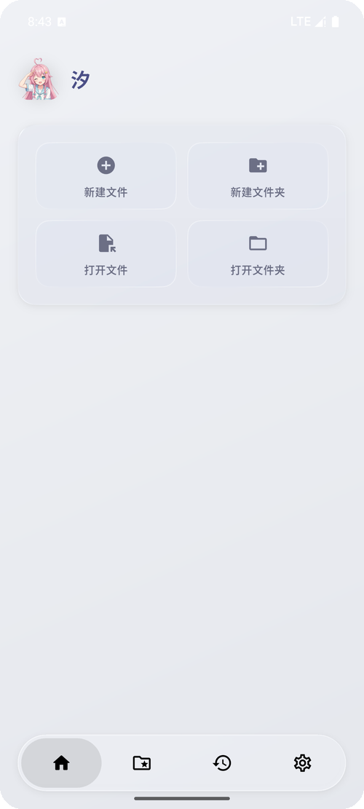
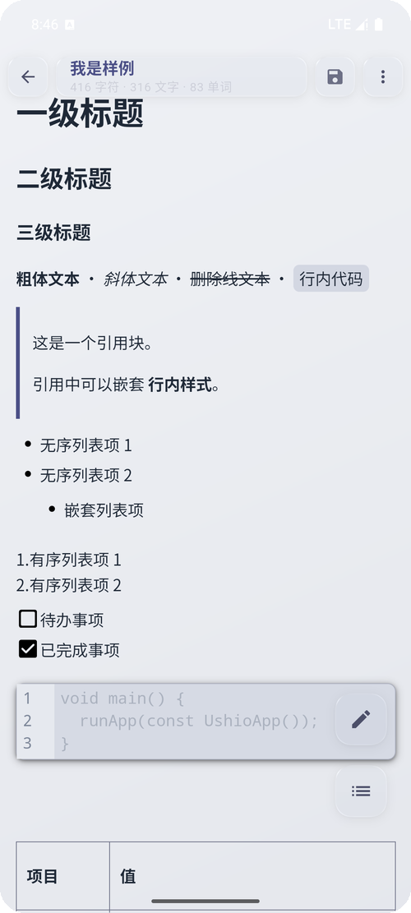
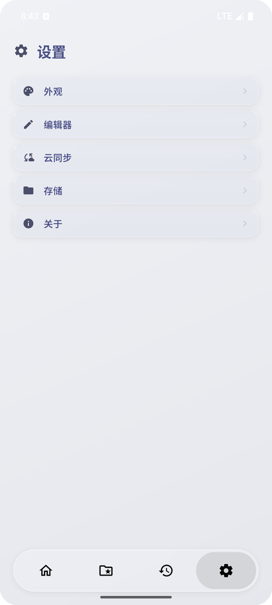

---
AIGC:
    Label: "1"
    ContentProducer: 001191440300708461136T1XGW3
    ProduceID: bd18877955418ac982ba109369444e03_26977ebfd43d11f1a97752540064ee0f
    ReservedCode1: 3CLPrujPq26j9dPYirfNWh4NWrpHNcCL40tJ008lBaSO6k/YbN0PHlC7Li0d8ByPBK7iitK9NMQ80cXkpzA7NFsqYF8EdZ2zeG48jSyOXXkrAfgnkgGnR/Fqo7o8vLMijrwRIpGVo3kxVVqAy089KHdUGA9qfQn76pHmjK0Gobejmn6vdwqXxvfskOY=
    ContentPropagator: 001191440300708461136T1XGW3
    PropagateID: bd18877955418ac982ba109369444e03_26977ebfd43d11f1a97752540064ee0f
    ReservedCode2: 3CLPrujPq26j9dPYirfNWh4NWrpHNcCL40tJ008lBaSO6k/YbN0PHlC7Li0d8ByPBK7iitK9NMQ80cXkpzA7NFsqYF8EdZ2zeG48jSyOXXkrAfgnkgGnR/Fqo7o8vLMijrwRIpGVo3kxVVqAy089KHdUGA9qfQn76pHmjK0Gobejmn6vdwqXxvfskOY=
---

# SAT0markdownEditor（沢）— 专注写作体验的 Markdown 编辑器

<p align="center">
  
</p>

<p align="center">
  <b>渲染即改 · 目录与搜索 · 版本历史 · 本地文件管理 · 同步与导出</b><br>
  Android / Windows 双平台 Markdown 编辑器，编辑器内核基于 Milkdown（ProseMirror）构建
</p>

<p align="center">
  
</p>

## 目录

- [项目简介](#项目简介)
- [功能特性](#功能特性)
- [优化成果（T-01 ~ T-14）](#优化成果t-01--t-14)
- [截图展示](#截图展示)
- [下载与安装](#下载与安装)
- [构建方式](#构建方式)
- [快速上手](#快速上手)
- [权限说明](#权限说明)
- [Markdown 支持](#markdown-支持)
- [常见问题](#常见问题)
- [反馈与支持](#反馈与支持)
- [开源协议](#开源协议)

## 项目简介

SAT0markdownEditor（应用名「沢」）是一个以写作为核心体验的 Markdown 编辑器：打开即写，渲染态直接点选内容即可修改，不必在源码与预览之间来回切换。编辑器内核基于 Milkdown（ProseMirror）在 WebView 中运行，Flutter 侧负责文件管理、版本历史、云同步等能力，两者通过消息桥接协同工作。

## 功能特性

### 编辑与预览

- 两种模式：渲染编辑（推荐，所见即所得）/ 纯文本编辑，可随时切换。
- 渲染态可直接点选段落、列表、标题与表格单元格就地修改。
- 底部格式工具栏只在编辑态出现，提供标题、粗斜体、删除线、列表、引用、代码、表格等常用格式的一键插入。
- 目录面板支持「跳转后保持打开」连续跳章节；全文搜索支持区分大小写、全词匹配与正则，并保留搜索历史。
- 代码块支持常见语言的语法高亮、语言选择，以及 One Dark / One Light / GitHub / Nord / Material 等代码块主题（可自动跟随明暗）。
- 支持数学公式（KaTeX 行内与块级）、表格增删行列、任务列表与 Emoji 短代码，以及 Mermaid 图表与脚注。
- 自动保存可开关并设置 15–600 秒间隔，退出时是否保存可单独设置；标题栏实时显示字符、文字与单词统计。
- 宽屏（平板 / 桌面）自动改用独立导航布局，桌面端另有自定义标题栏与快捷键帮助。
- 版本历史：每次保存生成快照，可查看任意版本的行级差异，并回退、加备注、删除或另存为新文档。

### 文件管理

- 首页快捷操作：新建文件、新建文件夹、打开文件、打开文件夹。
- 本地文件与文件夹浏览：新建、重命名、删除、分享，支持 7 种排序方式与文件名搜索。
- 文件与文件夹可置顶到首页并拖拽排序，最近访问记录集中在「历史」页查看，支持清除。
- 工作区名称与基础路径均可自定义，便于并入已有的目录结构。
- 打开外部 Markdown 时可选两种方式：
  - 仅查看（不改动原文件）
  - 导入工作区（会一并复制文中引用的图片）
- 也可以直接从系统分享面板把文件分享给沢。

### 个性化外观

- 主题模式：跟随系统、浅色、深色。
- 主题方案：浅色 5 套、深色 6 套纸面色板；强调色提供 10 个沉稳预设，也可自定义取色。
- UI 风格三选一：经典描边 / 简洁立体 / 液态玻璃（默认，含胶囊悬浮底部导航，四个页面可左右滑动或点图标切换）。
- 卡片外观、全局图标颜色、底部导航栏透明度分别可调，均提供自定义取色器。
- 页面背景与编辑器背景可各自设置图片，并支持背景模糊与亮度调节。
- 界面字体、编辑器字体、代码块字体三套独立；内置字体支持下载，也可安装本地自定义字体。
- 界面文字颜色与编辑器正文颜色分开设置；字号 6–80、行高、字间距、段落间距可调。
- 主页图标、主页标题与应用桌面图标均可替换（桌面图标仅 Android）。

### 同步与导出

- 云同步支持 WebDAV 与 FTP，可测试连接、指定云端目录与路径前缀。
- 支持手动「立即同步」，也可开启保存文件时自动同步（默认关闭）。
- 同步前提供预览与冲突处理：逐个文件选择保留本地、保留云端或跳过，冲突时还支持三方合并。
- 服务器密码保存在系统加密存储中，不以明文写入普通偏好设置。
- 导出与分享：PDF、按文档内容合成长图、原始文件分享，文件夹可打包为 ZIP。

## 优化成果（T-01 ~ T-14）

本项目按照 [优化路线图](docs/OPTIMIZATION_ROADMAP.md) 完成多轮性能、可靠性与工程质量优化：

| 编号 | 主题 | 成果 |
| --- | --- | --- |
| T-01 | 版本快照去重与保留策略 | 快照去重、容量上限保留策略，避免无限增长污染工作区 |
| T-02 | 云同步台账三方比较与并发传输 | SHA-256 内容哈希台账、并发传输、指数退避重试、断点续传 |
| T-03 | 应用内更新完整性校验 | checksums 校验、SHA-256 校验、包身份/签名/防降级三重校验，代理仅限 https |
| T-04 | WebView 安全加固 | CSP 替代可绕过正则、JS→Flutter 消息 19 种白名单 |
| T-05 | 启动路径优化 | 首帧前串行等待从 4 项减至 2 项，延后非必需初始化 |
| T-06 | 编辑变更行级增量回写 | 大文档（>50KB）按行级 patch 增量回写，单次消息 < 4KB |
| T-07 | 目录扫描移入 isolate | 递归扫描 + 逐文件 stat 移入独立 isolate，建立内存索引 |
| T-08 | 版本对比 patience diff | 移除 O(n·m) LCS 矩阵，5000 行典型对比耗时 < 200ms |
| T-09 | 拆分 God class | 编辑器三服务抽取、设置项按领域拆分为四个子 Provider（门面模式） |
| T-10 | CI 质量门禁与正式签名 | 补质量门禁与正式签名流程 |
| T-11 | Mermaid 与脚注支持 | 编辑器支持 Mermaid 图表与脚注渲染 |
| T-12 | 全局工作区搜索 | 复用内存索引 + isolate 全文 grep，可随时取消 |
| T-13 | 版本历史管理页 | 保留数量/容量上限配置、快照列表与一键清理 |
| T-14 | 同步冲突三方合并 | 基于 base 哈希的三路合并，冲突块逐块交互选择 |

> 完整细节见 [docs/OPTIMIZATION_ROADMAP.md](docs/OPTIMIZATION_ROADMAP.md)。

## 截图展示

> 截图版本为 V1.6.5（Android · 浅色 · 液态玻璃）

| 首页 | 编辑器 | 设置 |
|:---:|:---:|:---:|
| 快捷操作与胶囊导航 | 渲染态标题、列表、代码块与表格 | 外观 / 编辑器 / 云同步 / 存储 / 关于 |
|  |  |  |

## 下载与安装

### Android

请前往 [Releases](https://github.com/1700563146/SAT0markdownEditor/releases) 下载 **Release v1.6.9**，按设备架构选择 APK：

- `arm64-v8a`：近几年的绝大多数手机与平板
- `armeabi-v7a`：较老的 32 位 ARM 设备
- `x86_64`：模拟器与部分 x86 平板
- `universal`：不确定架构时选它（体积更大）

安装后按引导页授予文件访问权限。首次启动会预热编辑器内核，稍等片刻即可流畅打开文档；建议先在 设置 → 存储 中确认工作区位置。

**应用内更新**：设置 → 关于 中可手动检查更新、选择更新渠道（稳定版 / 预览版）、开启启动时自动检查。下载偏慢时可在「下载代理」里添加你自己的加速前缀。

### Windows

Windows 版仍在完善中，暂未发布安装包；如需体验可按下方「构建方式」自行编译。

## 构建方式

**系统要求（Windows 构建）：** Windows 10/11 (64-bit) + WebView2 运行时 (Windows 11 默认包含)。

```batch
# 构建 Android（按 ABI 分包 + 通用包）
build_abi_release.bat

# 构建 Windows
build_windows_release.bat

# 构建调试版 APK
build_debug.bat
```

详细构建说明请参考 [构建脚本文档](docs/BUILD_SCRIPTS.md)。

## 快速上手

1. 首次启动按引导授予文件权限，并在 设置 → 存储 中确认工作区位置。
2. 在首页新建或导入一个 `.md` 文件。
3. 点右下角目录按钮快速跳转章节；要改内容时直接点击渲染态文字，或点铅笔按钮进入编辑态。
4. 用搜索面板按关键词定位；改错了就打开右上角菜单 → 查看历史，对比差异并回退。
5. 需要分享时，在文档菜单中导出 PDF / 长图，或把整个文件夹打包成 ZIP。
6. 多设备协作：在 设置 → 云同步 中配置 WebDAV 或 FTP。

## 权限说明

| 权限 | 用途 |
| --- | --- |
| 存储读写权限 | 读取、保存和管理 Markdown 文件 |
| 管理所有文件（Android 11+） | 访问你指定的工作区与外部目录 |

> 未授予时应用会停在引导页，授予后自动进入首页。沢不会上传你的文件内容，除非你主动配置并执行云同步。

## Markdown 支持

| 语法 | 示例 | 效果 |
| --- | --- | --- |
| **粗体** | `**文字**` | **文字** |
| *斜体* | `*文字*` | *文字* |
| ~~删除线~~ | `~~文字~~` | ~~文字~~ |
| ==高亮== | `==文字==` | 高亮标记 |
| 标题 | `# 标题` | 层级标题 |
| 引用 | `> 内容` | 引用块 |
| 行内代码 | `` `代码` `` | `代码` |
| 代码块 | <code>```js<br>console.log('hi')<br>```</code> | 代码块、语法高亮与语言选择 |
| 链接 | `[文字](URL)` | [文字](URL) |
| 图片 | `` | 图片 |
| 无序列表 | `- 项目` | • 项目 |
| 有序列表 | `1. 项目` | 1. 项目 |
| 任务列表 | `- [ ] 待办` | ☐ 待办 |
| 分隔线 | `---` | --- |
| 表格 | `\| 列 \| 列 \|` | 完整表格支持，可在编辑态增删行列 |
| 行内公式 | `$E=mc^2$` | KaTeX 行内渲染 |
| 块级公式 | `$$E=mc^2$$` | KaTeX 块级渲染 |
| Emoji | `:smile:` / 😀 | Emoji 输入与渲染 |
| Mermaid 图表 | <code>```mermaid<br>graph TD; A-->B<br>```</code> | Mermaid 图表渲染 |
| 脚注 | `文字[^1]` | 脚注引用与列表 |
| HTML 行内标签 | `<kbd>Ctrl</kbd>` | 安全 HTML 渲染 |
| HTML 块 | `<table>...</table>` | 常见块级 HTML 渲染 |

> 说明：HTML 渲染会过滤危险标签与事件属性；支持 `table`、`div`、`section`、`article`、`details`、`figure` 等常见块级标签。

## 常见问题

### 云同步可以直接用于重要数据吗？

WebDAV 同步已通过本地自建服务器的上传、下载与冲突处理验证。连接公网服务器时建议使用 HTTPS，并只同步到可信服务器；重要数据仍建议额外保留一份备份。

### 打开外部 Markdown 文件后为什么不能直接编辑原文件？

这是为保护源文件安全。你可以选择“仅查看”，或使用“导入”将文件复制到工作区后编辑。

### 误删或改错了内容怎么恢复？

打开文档菜单的「查看历史」，沢会为每次保存留下快照。选中任意版本即可看到逐行差异，可以直接回退，也可以先另存为新文档再对比取舍。

### 长文档打开或编辑卡顿怎么办？

编辑器内核已在启动时预热并在文档间复用，正常情况下打开长文只需一次渲染；大文档的编辑变更采用行级增量回写，避免整篇重传。如果仍然偏慢，可降低背景图片的模糊强度、减少同时打开的文档数量，并保持应用在最新版本。

### 下载更新很慢或失败怎么办？

在 设置 → 关于 → 下载代理 中添加你自己的加速前缀（形如 `https://` 开头的地址），沢会按列表顺序依次尝试，全部失败时回退到原始地址。检查更新本身不经过代理，只有 APK 下载会。

## 反馈与支持

欢迎通过 [Issues](https://github.com/1700563146/SAT0markdownEditor/issues) 提交问题和建议。

如果这个项目对你有帮助，也欢迎点个 Star 支持一下。

## 开源协议

[MIT License](https://github.com/1700563146/SAT0markdownEditor/blob/main/LICENSE)
*（内容由AI生成，仅供参考）*
